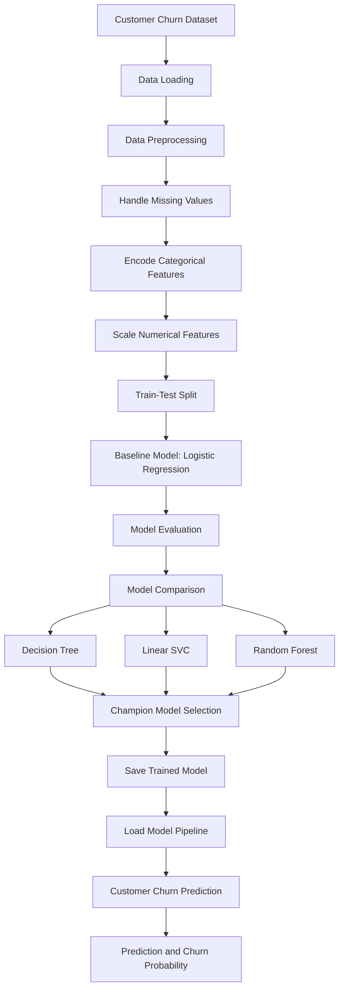

# RetailMind AI – Customer Churn Prediction

## 1. Project Overview

RetailMind AI is a machine learning project designed to predict customer churn in the telecommunications industry.

Customer churn occurs when a customer stops using a company's services. By analysing customer information, this project identifies customers who are likely to leave, helping businesses take proactive retention measures.

The project covers data preprocessing, machine learning model training, customer prediction, model evaluation, and model comparison.

## 2. Project Objectives

- Analyse customer data to identify churn patterns.
- Preprocess numerical and categorical features.
- Build a machine learning pipeline for churn prediction.
- Compare multiple classification algorithms.
- Select a champion model based on evaluation metrics.
- Generate churn predictions and probabilities for customers.

## 3. Project Structure

```text
RetailMind-AI/
│
├── Data/
│   └── Telco-Customer-Churn.csv
│
├── Notebooks/
│   ├── Train.ipynb
│   ├── predict.ipynb
│   └── predict_cmp.ipynb
│
├── models/
│   ├── churn_pipeline.joblib
│   └── champion_churn_pipeline.joblib
│
├── Src/
│   ├── __init__.py
│   └── preprocessing.py
│
├── requirements.txt
└── README.md
```

## 4. Project Workflow

The following flowchart represents the complete machine learning workflow.



## 5. Data Preprocessing

The dataset is preprocessed before training the machine learning models.

The preprocessing steps include:

- Converting `TotalCharges` into numeric format.
- Handling missing values.
- Removing the `customerID` column.
- Encoding the target variable (`Churn`).
- Applying median imputation and StandardScaler to numerical features.
- Applying OneHotEncoder to categorical features.
- Splitting the dataset into training and testing sets.

A Scikit-learn Pipeline and ColumnTransformer are used to combine preprocessing and model training.

## 6. Machine Learning Models

The project evaluates the following classification algorithms:

| Model | Purpose |
|---|---|
| Logistic Regression | Baseline model |
| Decision Tree | Challenger model |
| Linear SVC | Challenger model |
| Random Forest | Challenger model |

The baseline model is trained first. Challenger models are then compared to identify the best-performing model.

## 7. Model Performance

### Baseline Model – Logistic Regression

The baseline model achieved the following results:

| Evaluation Metric | Score |
|---|---:|
| Accuracy | 79.84% |
| Precision | 63.66% |
| Recall | 55.89% |
| ROC-AUC | 83.89% |

### Champion Model Selection

The challenger models are evaluated using Recall and ROC-AUC.

**Selected Champion Model: Linear SVC**

The champion model is saved as:

`champion_churn_pipeline.joblib`

## 8. Prediction Output

The prediction notebook loads the saved machine learning pipeline and generates churn predictions for customer records.

The output includes:

- Customer-level churn predictions.
- Predicted churn probabilities.
- Results for individual customer records.

### Prediction Output Format

| Customer | Churn Prediction | Churn Probability |
|---|---|---|
| Customer 1 | Generated by model | Generated by model |
| Customer 2 | Generated by model | Generated by model |
| Customer 3 | Generated by model | Generated by model |

*Note: Actual prediction values are generated when the prediction notebook is executed.*

## 9. Model Comparison

The model comparison notebook evaluates different machine learning algorithms to identify the champion model.

The comparison considers:

- Accuracy
- Precision
- Recall
- ROC-AUC

Recall is particularly important in churn prediction because identifying customers who are likely to leave helps businesses take preventive action.

## 10. Technologies Used

- **Programming Language:** Python
- **Data Processing:** Pandas, NumPy
- **Machine Learning:** Scikit-learn
- **Model Serialization:** Joblib
- **Development Environment:** Jupyter Notebook
- **Version Control:** Git and GitHub

## 11. Installation and Execution

### Step 1: Clone the Repository

```bash
git clone https://github.com/smruty9068/RetailMind-AI.git
```

### Step 2: Navigate to the Project Directory

```bash
cd RetailMind-AI
```

### Step 3: Install Dependencies

```bash
pip install -r requirements.txt
```

### Step 4: Open Jupyter Notebook

```bash
jupyter notebook
```

### Step 5: Execute the Notebooks

Run the notebooks in the following order:

1. `Train.ipynb` – Data preprocessing and baseline model training.
2. `predict.ipynb` – Customer churn prediction.
3. `predict_cmp.ipynb` – Model comparison and champion model selection.

## 12. Project Progress

### Day 1 – Completed
- Created project directory structure.
- Performed data preprocessing.
- Trained Logistic Regression baseline model.
- Generated customer churn predictions.
- Compared machine learning models.
- Saved trained model pipelines.

### Day 2 – Completed

**Objective:** Train and compare Decision Tree, Random Forest and SVM classifiers.

**Models Evaluated:**

| Model | Accuracy | Precision | Recall | ROC-AUC |
|---|---:|---:|---:|---:|
| Decision Tree | 78.48% | 61.52% | 50.32% | 82.24% |
| SVM | 79.39% | 64.36% | 49.89% | 79.73% |
| Random Forest | 78.36% | 61.44% | 49.46% | 80.41% |

**Champion Model: Decision Tree**

Selection criteria:
- Highest Recall: 50.32%
- Highest ROC-AUC: 82.24%

**Day 2 Deliverables:**
- Trained three classification models.
- Evaluated models using Accuracy, Precision, Recall and ROC-AUC.
- Selected the champion model.
- Saved `day2_champion_model.joblib`.
- Uploaded the notebook and model to GitHub.

### Upcoming Work
Further model improvements and project enhancements will be added in upcoming development days.
