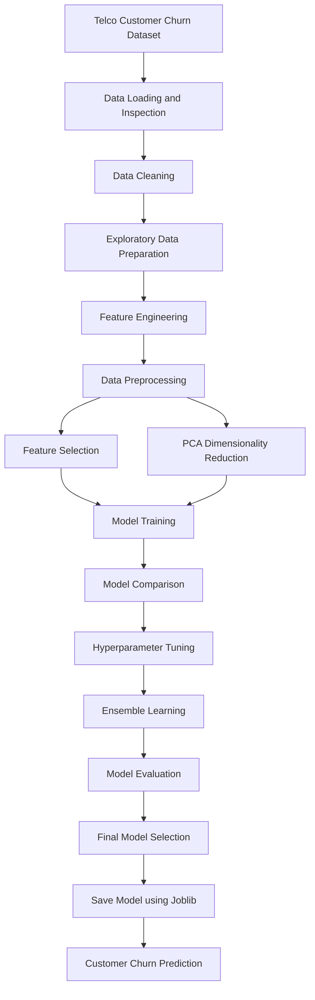

# RetailMind-AI: Customer Churn Prediction

## 1. Project Overview

RetailMind-AI is an incremental machine learning project focused on predicting customer churn using the Telco Customer Churn dataset.

Customer churn occurs when customers stop using a company's services. Predicting which customers are likely to leave helps businesses identify at-risk customers and develop better customer retention strategies.

This project follows a four-day development workflow, progressing from baseline model development to model comparison, hyperparameter tuning, feature engineering and ensemble learning.

---

## 2. Problem Statement

Customer retention is an important challenge for businesses.

Losing existing customers can affect revenue, profitability and long-term business growth.

The objective of this project is to develop a machine learning pipeline that predicts whether a customer is likely to churn based on their demographic information, account details, subscribed services and billing information.

### Project Objectives

- Analyse and prepare customer data.
- Perform data cleaning and preprocessing.
- Build a baseline classification model.
- Compare multiple machine learning algorithms.
- Perform hyperparameter tuning.
- Engineer meaningful features.
- Apply feature selection and dimensionality reduction.
- Implement ensemble learning techniques.
- Evaluate models using classification metrics.
- Save a reusable final prediction pipeline.

---

## 3. Dataset Description

**Dataset:** Telco Customer Churn

The dataset contains customer information, including:

- Customer demographics
- Gender and senior citizen status
- Tenure
- Contract information
- Internet and telephone services
- Monthly charges
- Total charges
- Churn status

**Dataset size:** 7,043 records and 21 original columns.

The `customerID` column was removed because it does not contribute meaningful predictive information.

The target variable is `Churn`:

| Value | Meaning |
|---|---|
| 0 | Customer does not churn |
| 1 | Customer churns |

---

## 4. Technologies and Libraries

### Programming Language
- Python

### Libraries
- Pandas
- NumPy
- Scikit-learn
- Matplotlib
- Joblib

### Development Environment
- JupyterLite
- Jupyter Notebook
- Git
- GitHub

---

## 5. Project Structure

```text
RetailMind-AI/
│
├── Data/
│   └── Telco-Customer-Churn.csv
│
├── Notebooks/
│   ├── Train.ipynb
│   ├── predict.ipynb
│   ├── predict_cmp.ipynb
│   ├── Day2_Model_Comparison.ipynb
│   ├── Day3_Model_Tuning.ipynb
│   └── Day4_Feature_Engineering.ipynb
│
├── models/
│   ├── churn_pipeline.joblib
│   ├── champion_churn_pipeline.joblib
│   ├── day2_champion_model.joblib
│   ├── churn_v3.joblib
│   └── final_churn_model.joblib
│
├── Src/
│   ├── __init__.py
│   └── preprocessing.py
│
├── requirements.txt
└── README.md
```

---

# 6. Project Development

## Day 1 – Baseline Model Development

The first day focused on understanding the dataset, preparing the data and developing an initial churn prediction model.

### Tasks Performed

- Loaded the Telco Customer Churn dataset.
- Removed unnecessary customer identifiers.
- Converted `TotalCharges` into numeric format.
- Handled missing values.
- Encoded categorical variables.
- Applied numerical feature scaling.
- Built a machine learning pipeline.
- Trained a Logistic Regression classifier.
- Saved the trained pipeline using Joblib.
- Generated customer churn predictions.

### Preprocessing Techniques

**Numerical Features**
- Median imputation
- StandardScaler

**Categorical Features**
- Most frequent value imputation
- OneHotEncoder

### Baseline Model

Algorithm: Logistic Regression

### Performance Results

| Evaluation Metric | Score |
|---|---:|
| Accuracy | 79.84% |
| Precision | 63.66% |
| Recall | 55.89% |
| ROC-AUC | 83.89% |

### Outcome

A baseline Logistic Regression pipeline was successfully developed and saved.

The model established the initial performance benchmark for subsequent experiments.

---

## Day 2 – Machine Learning Model Comparison

The second day focused on comparing different classification algorithms to identify models with better predictive performance.

### Algorithms Compared

1. Decision Tree Classifier
2. Random Forest Classifier
3. Support Vector Machine (SVM)

### Tasks Performed

- Reused the preprocessing pipeline.
- Split the dataset into training and testing sets.
- Trained multiple classification algorithms.
- Evaluated model performance.
- Compared accuracy, precision, recall and ROC-AUC.
- Selected a Day 2 champion model.

### Dataset Splitting

- Training set: 75%
- Testing set: 25%
- Random state: 67
- Stratified splitting

### Model Comparison Results

| Model | Accuracy | Precision | Recall | ROC-AUC |
|---|---:|---:|---:|---:|
| Decision Tree | 78.48% | 61.52% | 50.32% | 82.24% |
| SVM | 79.39% | 64.36% | 49.89% | 79.73% |
| Random Forest | 78.36% | 61.44% | 49.46% | 80.41% |

### Champion Model

**Decision Tree Classifier**

The Decision Tree model was selected as the Day 2 champion based on its recall and ROC-AUC performance among the compared models.

The trained model was saved as:

`day2_champion_model.joblib`

---

## Day 3 – Hyperparameter Tuning and Model Optimization

The third day focused on improving model performance through hyperparameter optimization and model evaluation.

### Algorithms Tuned

- Decision Tree
- Random Forest
- Support Vector Machine

### Techniques Used

**1. GridSearchCV**

GridSearchCV was used to identify suitable hyperparameter combinations through cross-validation.

Configuration:

- Cross-validation folds: 3
- Scoring metric: Recall

**2. Learning Curves**

Learning curves were generated to understand model performance as the training dataset size increased.

**3. Bias-Variance Analysis**

Training and validation performance were examined to understand potential underfitting and overfitting.

### Final Test Results

| Model | Accuracy | Precision | Recall | ROC-AUC |
|---|---:|---:|---:|---:|
| Random Forest | 80.12% | 64.59% | 55.46% | 82.96% |
| SVM | 79.10% | 62.41% | 53.32% | 82.78% |
| Decision Tree | 78.25% | 60.50% | 51.82% | 81.95% |

### Champion Model

**Tuned Random Forest Classifier**

Random Forest achieved the highest recall and ROC-AUC among the three tuned models.

The trained model was saved as:

`churn_v3.joblib`

---

## Day 4 – Feature Engineering, Dimensionality Reduction and Ensemble Learning

The fourth day focused on improving the feature representation and evaluating ensemble learning techniques.

### 1. Feature Engineering

The following features were created:

**TenureGroup**

Customers were grouped based on their tenure:

- New
- Short
- Medium
- Long

**ChargePerTenure**

A feature was created using total charges divided by tenure plus one.

**HighMonthlyCharge**

A binary indicator identifying customers whose monthly charges are above the dataset median.

**LongTermContract**

A binary indicator identifying customers with contracts other than month-to-month.

### 2. Feature Selection

SelectKBest with Mutual Information was applied to identify informative features.

- Selection method: SelectKBest
- Scoring function: mutual_info_classif
- Selected features: 15

Feature selection was fitted using training data.

### 3. Principal Component Analysis (PCA)

PCA was applied to reduce the dimensionality of the processed feature space.

| Parameter | Result |
|---|---:|
| Original Features | 52 |
| PCA Components | 20 |
| Variance Retained | 95.47% |

PCA reduced the feature space from 52 dimensions to 20 while retaining approximately 95.47% of the variance.

### 4. Ensemble Learning

The following ensemble models were evaluated:

- Bagging Classifier
- Random Forest Classifier

The Bagging Classifier used Decision Tree estimators.

Random Forest was evaluated as a separate ensemble model.

### Ensemble Model Results

| Model | Accuracy | Precision | Recall | ROC-AUC |
|---|---:|---:|---:|---:|
| Bagging | 79.61% | 63.99% | 52.89% | 83.21% |
| Random Forest | 79.22% | 63.05% | 52.25% | 82.71% |

### PCA-Based Ensemble Results

Bagging was also evaluated using PCA-transformed features.

| Metric | PCA Bagging |
|---|---:|
| Accuracy | 79.67% |
| Precision | 64.61% |
| Recall | 51.61% |
| ROC-AUC | 82.81% |

### Day 4 Model Selection

Bagging using selected features achieved the highest recall and ROC-AUC among the Day 4 ensemble experiments.

Therefore, it was selected as the Day 4 champion candidate.

The final pipeline was saved as:

`final_churn_model.joblib`

It includes:

- Data preprocessing
- Feature selection
- Bagging classifier

**Note:** XGBoost installation was attempted but could not be completed because its compiled dependencies were unavailable in the JupyterLite environment. Therefore, XGBoost results are not included in the model comparison.

---

# 7. Overall Model Comparison

The following table summarises the selected models from each development stage.

| Development Stage | Selected Model | Accuracy | Recall | ROC-AUC |
|---|---|---:|---:|---:|
| Day 1 | Logistic Regression | 79.84% | 55.89% | 83.89% |
| Day 2 | Decision Tree | 78.48% | 50.32% | 82.24% |
| Day 3 | Random Forest | 80.12% | 55.46% | 82.96% |
| Day 4 | Bagging | 79.61% | 52.89% | 83.21% |

**Important:** The models were developed and evaluated in different experimental stages. The results above are the recorded results from each stage, not a single controlled comparison of all four models.

---

# 8. Machine Learning Workflow

The overall project workflow is illustrated below.



---

# 9. Prediction Example

The final trained pipeline can be loaded and used to generate predictions for new customer records.

### Loading the Model

```python
import joblib

model = joblib.load(
    "models/final_churn_model.joblib"
)
```

### Generating Predictions

```python
predictions = model.predict(X_test.head(5))

print("Predictions:", predictions)
```

### Example Output

```text
Predictions: [0 1 1 0 0]
```

### Prediction Interpretation

| Prediction | Meaning |
|---|---|
| 0 | Customer is predicted not to churn |
| 1 | Customer is predicted to churn |

The final pipeline accepts raw customer feature records and performs preprocessing and feature selection before generating predictions.

---

# 10. Reusable Preprocessing Module

The project includes a reusable preprocessing module:

`Src/preprocessing.py`

It contains:

### clean_data(df)

- Removes unnecessary customer identifiers.
- Converts TotalCharges into numeric format.
- Converts the Churn target into binary values.

### create_preprocessor(X)

- Identifies numerical and categorical columns.
- Handles missing values.
- Applies StandardScaler to numerical features.
- Applies OneHotEncoder to categorical features.
- Returns a ColumnTransformer preprocessing pipeline.

This module helps organise reusable preprocessing logic separately from the experiment notebooks.

---

# 11. Installation and Requirements

Clone the repository:

```bash
git clone https://github.com/smruty9068/RetailMind-AI.git
```

Navigate to the project directory:

```bash
cd RetailMind-AI
```

Install the required libraries:

```bash
pip install -r requirements.txt
```

### Requirements

The project uses the following Python libraries:

- pandas
- numpy
- scikit-learn
- joblib
- matplotlib

---

# 12. Key Learnings

Through this project, the following concepts were explored:

- Data cleaning and preprocessing
- Handling missing values
- Numerical scaling
- Categorical encoding
- Machine learning pipelines
- Classification algorithms
- Model comparison
- Cross-validation
- Hyperparameter tuning
- Learning curves
- Bias-variance analysis
- Feature engineering
- Feature selection
- Principal Component Analysis
- Ensemble learning
- Model serialization using Joblib
- Git and GitHub version control

---

# 13. Future Improvements

Potential improvements include:

- Training and evaluating XGBoost in a compatible environment.
- Improving churn recall.
- Performing additional feature engineering.
- Evaluating additional ensemble algorithms.
- Testing the final model on new customer data.
- Developing a FastAPI-based prediction service.
- Creating an interactive customer churn prediction dashboard.
- Monitoring model performance over time.

---

# 14. Conclusion

RetailMind-AI demonstrates an incremental machine learning workflow for telecom customer churn prediction.

The project progresses through four development stages:

1. Baseline model development
2. Machine learning model comparison
3. Hyperparameter tuning and optimization
4. Feature engineering, dimensionality reduction and ensemble learning

Different algorithms and preprocessing techniques were evaluated to understand their impact on customer churn prediction.

The final Day 4 pipeline combines preprocessing, feature selection and Bagging classification into a reusable model that can generate churn predictions from customer records.

The project demonstrates the practical application of machine learning concepts, model evaluation, feature engineering and version-controlled development.

---

## 15. Repository

**GitHub Repository:**

https://github.com/smruty9068/RetailMind-AI

**Project:** RetailMind-AI

**Domain:** Machine Learning / Customer Churn Prediction

**Status:** Four development stages completed.
